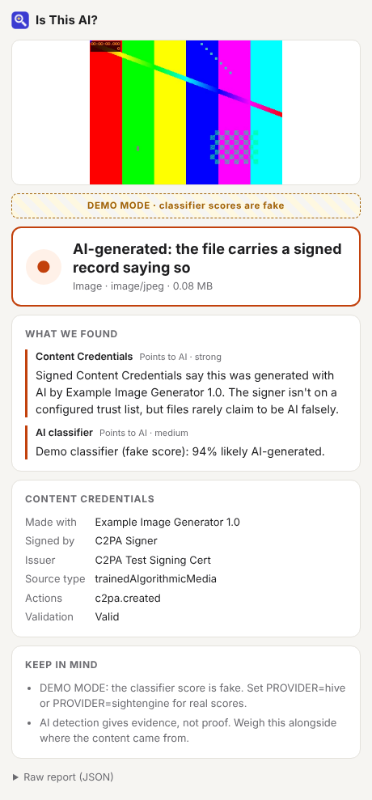
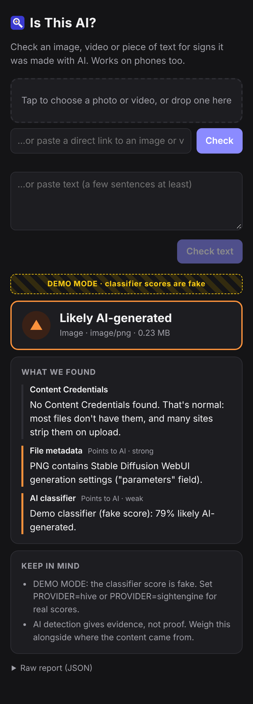

# Is This AI? (proof of concept)

Right-click an image, video, link or selected text in Chrome or Edge and get a plain-language answer about whether it was made with AI, plus the evidence behind it.

<p>
  
  
</p>

## What's in here

| Folder | What it is |
|---|---|
| `backend/` | Node.js API that runs the checks, and a web page for uploading files by hand (also works on phones) |
| `extension/` | Chrome/Edge extension (Manifest V3): right-click menu, toolbar popup and settings page |
| `e2e/` | Automated test that loads the extension into Chrome and runs real checks |
| `docs/screenshots/` | Screenshots from the automated test |

## How a check works

Each check runs three layers of evidence, then combines them into one result:

1. **Content Credentials (C2PA).** This is a signed record of how the file was made. The backend reads it with Adobe's open-source [`c2pa-node`](https://github.com/contentauth/c2pa-js) library. If the record is intact and says the file was AI-generated, that's the strongest signal available. It also catches tampering: if the file was changed after signing, validation fails and the record is ignored.
2. **File metadata.** Looks for traces that generators leave behind, such as Stable Diffusion or ComfyUI settings in PNG files, AI tool names in EXIF/XMP fields, and the IPTC "trainedAlgorithmicMedia" label. These are useful but easy to strip or fake.
3. **AI classifier.** A machine-learning service that estimates how likely it is that the content is AI-generated. This POC ships with a **demo classifier that returns fake scores** (clearly labeled in the UI), plus ready-made connectors for **Hive** and **Sightengine**. Add an API key to get real scores.

Possible results, from strongest to weakest: *AI-generated (signed record)*, *Contains AI-generated parts*, *Likely AI*, *Possibly AI*, *Inconclusive*, *No signs of AI found*, *Verified camera capture*.

Text checks are deliberately capped at "Possibly AI" or "Inconclusive", because text detectors are often wrong.

## Quick start (about 5 minutes)

You need **Node.js 22.23.4 or newer** (an older Node 22 won't work with the C2PA library).

```bash
cd backend
npm install
npm start            # → http://localhost:8787
```

Open http://localhost:8787 to try the web page.

Then load the extension:

1. Go to `chrome://extensions` (or `edge://extensions`).
2. Turn on **Developer mode**.
3. Click **Load unpacked** and pick the `extension/` folder.
4. Right-click any image, video, link or selected text and choose **Is this AI?**

The toolbar icon opens a popup where you can drop in files or paste text, and it shows whether the backend is connected.

### Trying it on a phone

Phones can't install Chrome extensions, but the web page works in a phone browser. With the backend running on your computer, open `http://<your-computer's-IP>:8787` from a phone on the same Wi-Fi.

### Test files

`backend/test/fixtures/` includes files to try, all made by `npm run fixtures`:

| File | What it should show |
|---|---|
| `ai-c2pa.jpg`, `clip-ai-c2pa.mp4` | AI-generated (signed record) |
| `sd-params.png` | Likely AI (Stable Diffusion settings in the PNG) |
| `photo-camera-c2pa.jpg` | Camera claim from a test signer, so only a weak hint |
| `photo-plain.jpg`, `clip-plain.mp4` | Depends on the classifier score alone |

These are signed with the public C2PA **test** certificate, which isn't trusted in the real world, and the result window says so.

## Getting real classifier scores

```bash
cd backend
cp .env.example .env
# then edit .env:
PROVIDER=sightengine          # or: hive
SIGHTENGINE_API_USER=...
SIGHTENGINE_API_SECRET=...
```

Restart with `npm start`. The startup message and the popup show which classifier is active.

- **Sightengine** has a free tier and handles images and videos under about a minute.
- **Hive** handles images, video and deepfakes, and suggests which generator was likely used.
- Neither connector has been tested against the live service in this POC, since that needs your keys. The request and response formats follow each vendor's public docs.
- To add another vendor, copy `backend/src/providers/mock.js`, then register it in `providers/index.js`.

## API

`POST /api/check` accepts any one of:

- multipart form with a `file` field (optionally `sourceUrl`, `pageUrl`)
- JSON `{ "url": "https://…/image.jpg" }`, which the server downloads
- JSON `{ "text": "…" }`

It returns a report like this:

```json
{
  "kind": "image",
  "verdict": { "level": "ai_confirmed", "headline": "…", "signals": [ … ], "caveats": [ … ], "demo": true },
  "c2pa": { "present": true, "intact": true, "origin": "ai", "tool": "…", "signer": "…" },
  "metadata": { … },
  "classifier": { "provider": "mock", "score": 0.94, … }
}
```

`GET /api/health` returns which classifier is active.

## Tests

```bash
cd backend && npm test                                   # 18 unit and API tests
cd e2e && npm install && CHROME_PATH=/path/to/chrome npm test   # extension in real Chrome, 14 checks
```

## Known limitations

- **Streamed video can't be checked.** Sites like YouTube, TikTok and Instagram stream video in pieces (`blob:` addresses), so there's no single file to send. The extension says so clearly. Downloaded files work.
- **Most files have no Content Credentials.** Social sites often strip them on upload, so the classifier ends up doing most of the work.
- **SynthID (Google's invisible watermark) isn't wired in yet.** Google's detection API is gated, so you'd need to apply for access. It would slot in as another signal.
- **The server fetches URLs it's given.** It blocks private-network addresses, but before exposing it publicly, add authentication and rate limiting and run it behind a proxy.
- **The C2PA trust list isn't configured by default.** Set `C2PA_TRUST_ANCHORS` to the official C2PA trust list so trusted cameras can show "Verified camera capture".
- **GitHub Pages can't run this.** Pages only serves static files, and the checker needs a server (for example Render, Fly.io or Azure App Service).

## What comes next

1. Turn on a real classifier and try it on known AI and real images.
2. Host the backend, then point the extension at it (toolbar icon → backend status → settings).
3. Add iPhone and Android **share extensions** that send to the same API: Share → "Check for AI".
4. Add **Mac and Windows** right-click menu entries for files.
